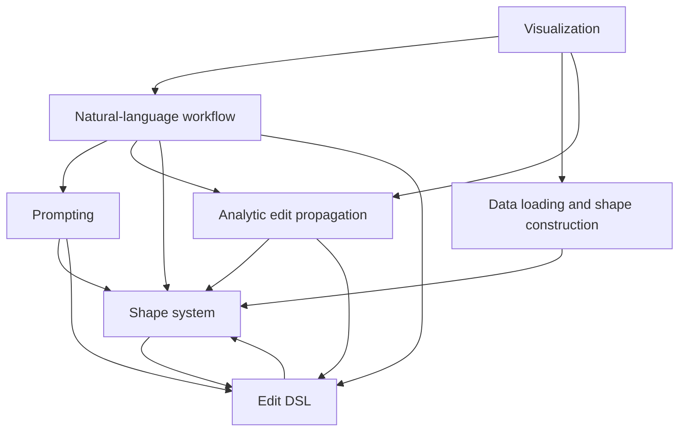

# ParSEL architecture

This document records the boundaries used to migrate the research system from
`edit_sys`. The migration first changed arrangement and imports only. A
separate, test-driven correction pass followed after behavioral parity.

## Design rules

1. Keep the public system small. No plugin framework, registries, abstract
   factories, or speculative extension points.
2. Prefer functions. Classes are reserved for stateful domain objects such as
   parts, relations, edits, the proposer, and the interactive application.
3. Keep the edit language and shape model as two explicit namespaces within
   one domain kernel. They genuinely depend on each other; forcing an
   interface layer between them would add machinery without reducing
   coupling.
4. Prompting decides intent. Propagation enforces geometry. The workflow is the
   only place that coordinates both.
5. Optional systems must stay optional. Importing `parsel` must not initialize
   an LLM client, load a dataset, or import the GUI.
6. There is one supported workflow and one supported prompt set. Historical
   versions are migration inputs, not public concepts.

## Package map

```text
src/parsel/
├── __init__.py          intentionally minimal package root
├── shape_system/
│   ├── constants.py     shape, relation, and solver constants
│   ├── math.py          symbolic/numeric helper functions
│   ├── geometry.py      vectors, lines, and planes
│   ├── shape.py         parts, cuboid proxies, and features
│   ├── relations.py     contacts and symmetry relations
│   └── annotations.py   domain descriptions used in prompts and logs
├── edit_dsl/
│   ├── language.py      user-facing edit constructors
│   └── edits.py         concrete analytic edit objects
├── edit_propagation/
│   ├── proposer.py      candidate generation and symbolic solving
│   ├── scoring.py       validation and deformation scoring
│   ├── parallel.py      optional parallel candidate evaluation
│   └── deformation.py   proxy-to-mesh deformation
├── prompting/
│   ├── context.py       prompt descriptions of shapes and relations
│   ├── parsing.py       code-block and output parsing
│   ├── prompter.py      the single supported prompt workflow
│   ├── clients.py       provider adapters and usage logging
│   ├── state.py         API usage counters
│   └── prompts/         the single supported prompt set
├── workflow.py          natural language → analytic edit program
├── data/                part-segmented mesh loading and shape construction
└── visualization/       optional Open3D application
```

The subsystem packages are the public organization. The root package does not
re-export their classes and functions: callers use imports such as
`parsel.shape_system.shape`, `parsel.edit_dsl.language`, and
`parsel.edit_propagation.proposer`.

## Dependency direction

Arrows mean “depends on”:



In code, `workflow` imports both `prompting` and `edit_propagation`; neither
imports `workflow`. Visualization and dataset loading are never imported by
the root package.

## Migration passes

### Pass 1: arrangement — complete

- Move the current, tested implementations into the map above.
- Change import paths and public names only.
- Retain the characterized algorithms internally while changing their package
  arrangement.
- Export one stable facade even if the internal prompting inheritance has not
  yet been flattened.
- Port the Phase 0 characterization suite and require matching results.

### Pass 2: corrections — complete

- Fixed issues demonstrated by focused tests.
- Collapsed the prompt-version inheritance into one implementation.
- Removed alternate workflow and prompt versions from the supported package.
- Restricted model output to an assignment-only edit DSL.
- Removed the duplicate edit-generator facade and obsolete candidate-cache
  workflow.
- Fixed typed candidate gathering against the supported NumPy version.
- Made cached dataset loading independent of raw-preprocessing dependencies
  and verified it against a read-only real shape.
- Kept optional dataset, LLM, and visualization dependencies out of the core
  import.
- Preserved the full characterization suite throughout the corrections.

### Pass 3: public namespaces — complete

- Replaced the flat module layout with `shape_system`, `edit_dsl`,
  `edit_propagation`, `prompting`, and `data` namespaces.
- Kept `parsel.__init__` minimal instead of maintaining compatibility aliases.
- Added maintained scripts for automated tests and read-only shape inspection.
- Updated the full suite to exercise the new imports directly.
- Deferred visualizer behavior changes to its own test-driven pass.

### Pass 4: data boundary — complete

- Replaced the PartNet-named shared entry point with
  `parsel.data.loading.load_shape`.
- Made `dataset="partnet"` or `dataset="compat3d"` mandatory instead of
  inferring it from a pathname.
- Made raw regeneration explicit and prevented missing or invalid caches from
  causing hidden writes.
- Kept the loader module importable without Open3D; geometry dependencies are
  loaded only when a shape is actually constructed.

### Pass 5: shape invariants — complete

- Removed the obsolete `Part(mode="old"|"new")` lookup versions.
- Made bare-label lookup require uniqueness and hierarchy paths deterministic.
- Fixed recursive feature and primitive collection.
- Replaced relation debug printing and interactive debugger entry with quiet,
  explicit error behavior.

### Pass 6: edit propagation — complete

- Made both proposer implementations return an explicit no-candidate result
  when a relation cannot produce an update.
- Removed solver timing and diagnostic output from library calls.
- Kept the symbolic algorithms intact while adding focused regression tests
  for their failure boundaries.

### Pass 7: prompting and workflow — complete

- Reduced initialization to the single parallel prompting API used by
  `Prompter`; the obsolete sequential compatibility path is gone.
- Replaced the ambiguous `mode` name with `provider` and stopped mutating
  OpenAI module state or API-key environment variables.
- Added strict validation for seed edits, type hints, relation states, and
  tied votes before prompt results reach propagation.
- Added an explicit workflow iteration limit so invalid or incomplete prompt
  decisions fail instead of looping indefinitely.
- Kept API counters as simple module-level functions rather than a singleton
  namespace class.

### Pass 8: visualization — complete

- Characterized geometry maps, visibility state, saved-program replay, slider
  callbacks, edit removal, relation glyphs, and command-line entry points.
- Replaced the stale `EditSysApp` names with `ParselApp` and
  `OnlineParselApp`; no compatibility aliases remain.
- Fixed per-part label visibility, negative-axis arrow and plane construction,
  multi-mesh vertex offsets, and CPU fallback for dynamic model updates.
- Removed a duplicate ground-shape load that unnecessarily pulled raw
  preprocessing dependencies into cached-shape window startup.
- Reduced the offscreen renderer to active-mesh setup, scene lighting,
  camera/ground placement, and PNG output; it no longer depends on the GUI
  application or optional mesh-export libraries.
- Added explicit read-only scripts for PNG rendering and interactive window
  startup, with outputs isolated beneath `.test-output/`.
- Verified visualization state on both real datasets, rendered both with
  Open3D/EGL, and exercised the GUI lifecycle under Xvfb.

### Pass 9: evaluation metadata — complete

- Replaced the opaque curated-selection pickles with checked-in PartNet and
  Compat3D CSV files.
- Preserved the PartNet legacy row position separately from its stored
  `dataset_index` instead of hiding two inconsistent source rows.
- Joined PartNet category and ShapeNet model IDs from the full catalog.
- Removed only the Compat3D aggregate row, normalized its headers, and
  preserved a genuinely missing annotation as an empty value.
- Added a deterministic converter with validation, safe overwrite behavior,
  and a check mode for provenance verification.

## Explicit non-goals

- General mesh-edit plugin APIs.
- User-defined relation/edit class registration.
- Multiple simultaneous prompting strategies.
- Backward compatibility with every experimental script.
