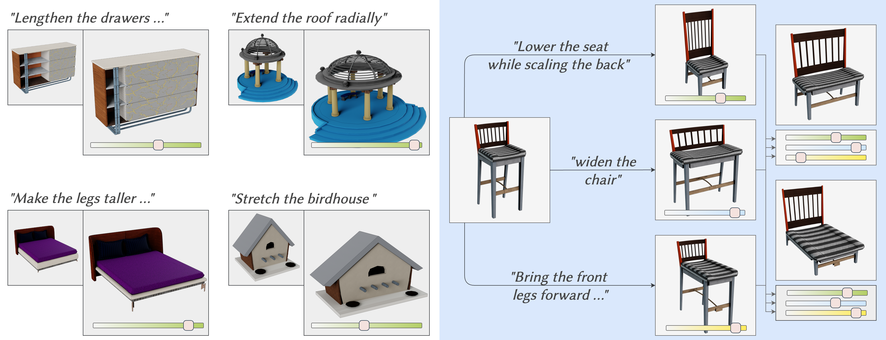
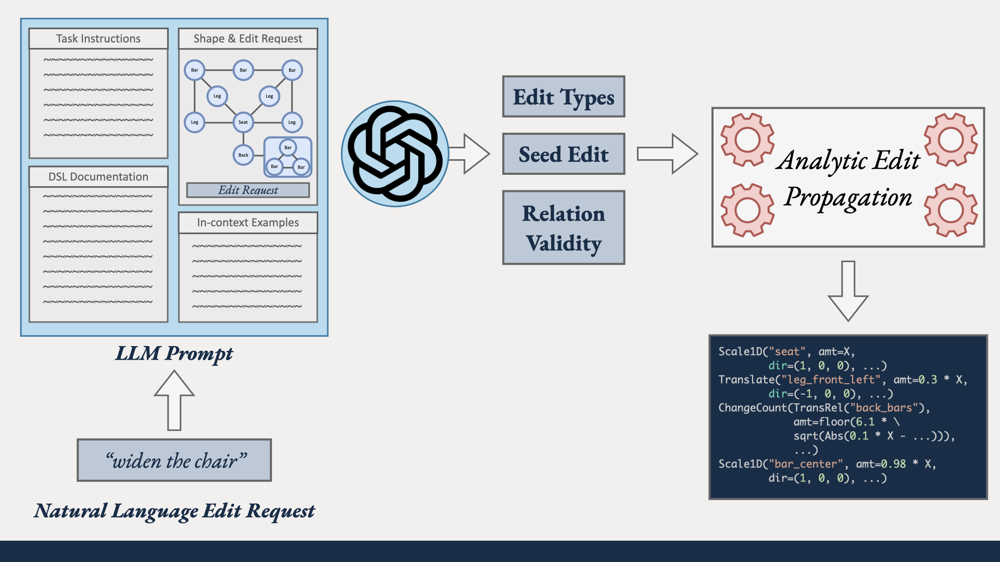

> **Code release note:** This codebase has been cleaned and packaged using
> ChatGPT sol 5.6 and sol 6.1. Please [reach out](mailto:adityaganeshan@gmail.com)
> if you need the original research code.

This repository is a static publication snapshot of the cleaned code; it is
not automatically synchronized with the development repository.

<div align="center">

# ParSEL: Parameterized Shape Editing with Language

**SIGGRAPH Asia 2024 · ACM Transactions on Graphics**

[Aditya Ganeshan](https://bardofcodes.github.io/) ·
[Ryan Y. Huang](https://ryanhuang.dev/) ·
[Xianghao Xu](https://xxh43.github.io/) ·
[R. Kenny Jones](https://rkjones4.github.io/) ·
[Daniel Ritchie](https://dritchie.github.io/)

Brown University

[Project Page][project] · [Paper (PDF)][paper] · [arXiv][arxiv] ·
[Supplementary Material][supplement] · [ACM TOG][publication]

</div>

<p align="center">
  <a href="https://bardofcodes.github.io/parsel/">
    
  </a>
</p>

*Natural-language requests become adjustable shape edits (left). Multiple
programs can be composed to explore new variations (right).*

ParSEL turns a natural-language request and a part-segmented 3D shape into a
compact **parameterized editing program**. Language specifies *what* should
change; an interactive parameter gives the user precise control over *how
much* it changes.

[Data Release](#data-release) · [Install](#installation) ·
[Quick Start](#quick-start-replay-a-released-result) ·
[Generate an Edit](#generate-an-edit-from-language) ·
[Evaluation](#evaluation-and-released-outputs) · [Citation](#citation) ·
[MIT License](LICENSE)

## What ParSEL does

Given a segmented mesh and a request such as “make the chair wider,” ParSEL:

1. asks a large language model for a small seed edit;
2. detects contact and symmetry relations that the seed edit would break;
3. uses **Analytical Edit Propagation (AEP)** to add closed-form secondary
   edits that preserve those relations; and
4. exposes the resulting program as an interactive slider in Open3D.

The output is a symbolic program, not a single deformed mesh. One program can
therefore generate a continuous family of shapes and can be composed with
other ParSEL programs.

<p align="center">
  
</p>

## What you can do with this repository

| Goal | LLM required? | Entry point |
| --- | :---: | --- |
| Replay and inspect a released edit program | No | [Open3D viewer](scripts/visualize_shape.py) |
| Generate a program from a language request | Yes | [Edit solver](scripts/solve_edit.py) |
| Build edits directly with the symbolic DSL | No | [Edit DSL](src/parsel/edit_dsl/language.py) |
| Run AEP from a supplied seed edit | No | [Offline seed workflow](docs/INSTALL.md#llm-configuration) |
| Rebuild evaluation programs from archived decisions | No | [Archived-output replay](scripts/replay_archived_outputs.py) |
| Validate and inspect all 102 evaluation outputs | No | [Output checker](scripts/check_replay_outputs.py) |

The core package is organized around a small domain kernel (`shape_system` and
`edit_dsl`), with prompting, propagation, data loading, and visualization kept
as explicit subsystems. See [ARCHITECTURE.md](ARCHITECTURE.md) for the design
boundaries.

## Data release

The Hugging Face release contains **saved edit programs for 102
curated language requests**, without redistributing the source datasets.

| Archive | Size | Contents |
| --- | --- | --- |
| `parsel_edit_programs.zip` | 306 KiB | 102 saved programs, readable results, sanitized run logs, both request CSVs, manifests, generation settings, and provenance |

The requests comprise **52 PartNet edits and 50 3DCoMPaT++ edits**, referring
to 47 distinct PartNet shapes and 50 distinct 3DCoMPaT++ shapes. Some PartNet
requests reuse a shape. The saved outputs are adjustable symbolic programs,
not exported edited meshes.

**99 programs were regenerated using the cleaned implementation.** Three
are explicitly marked `archived_fallback`: `partnet:42`, `partnet:51`, and
`compat3d:38`. This distinction is preserved in the output manifest and
per-example records. Replay does not require an API key or a new LLM call.

The Hugging Face package excludes source meshes, textures, annotations,
processed shape caches, model checkpoints, provider credentials, and local
visual-review scores. The existing `parsel_experiment_data.zip` is a local
input bundle, **not** part of this upload.
All 102 saved programs pass the output checker; that structural validation
does **not** establish that every edit looks good.

The output-only archive is uploaded as a
[private Hugging Face draft](https://huggingface.co/datasets/bardofcodes/parsel-edit-programs).
The [artifact release guide](docs/HUGGING_FACE.md)
provides the dataset card, checksums, and upload instructions. The code is MIT
licensed. The PartNet subset retains PartNet / ShapeNet terms, and the
3DCoMPaT++ subset retains its dataset agreement; there is no blanket MIT data
license. See [LICENSES.md](LICENSES.md) for the source-specific restrictions.

You can validate and read the programs without shape inputs or an API key.
Open3D replay additionally requires separately obtained, compatible processed
inputs. See [input access and preparation](docs/INPUTS.md): downloading a raw
mesh alone does not recreate the part and relation indices used by a program.

## Installation

ParSEL requires Python 3.10 or newer. Python 3.10 is recommended for the
Open3D stack used by the interactive viewer.

```bash
git clone https://github.com/BardOfCodes/parsel.git
cd parsel

python3.10 -m venv .venv
source .venv/bin/activate
python -m pip install --upgrade pip
```

Choose the smallest install for the workflow you need:

```bash
# Symbolic DSL and analytical propagation
python -m pip install -e .

# Replay cached shapes and saved programs in Open3D
python -m pip install -e ".[viewer]"

# Add natural-language prompting
python -m pip install -e ".[viewer,prompting]"

# Develop and run the portable test suite
python -m pip install -e ".[test]"
python scripts/run_tests.py --portable
```

Raw mesh preprocessing and the complete visualization stack have additional
platform-sensitive dependencies. The full install matrix and troubleshooting
notes are in the [installation guide](docs/INSTALL.md).

## Quick start: replay a released result

Download and verify `parsel_edit_programs.zip` following the
[artifact guide](docs/HUGGING_FACE.md#download-and-verify), then extract it
beside the code repository. It creates `parsel_clean_outputs/`. Validate the
complete set and print one program without needing shape inputs:

```bash
python scripts/check_replay_outputs.py ../parsel_clean_outputs --show partnet:0
```

To replay a result, first obtain compatible processed inputs separately as
described in [INPUTS.md](docs/INPUTS.md). If they are arranged under
`../parsel_experiment_data`, the checker can also print the viewer command:

```bash
python scripts/check_replay_outputs.py \
    ../parsel_clean_outputs \
    --show partnet:0 \
    --data-root ../parsel_experiment_data
```

The command validates all 102 saved programs and prints the exact Open3D
command for the selected row. Rows are addressed as `partnet:0..51` and
`compat3d:0..49`.

To open PartNet row 0 directly:

```bash
python scripts/visualize_shape.py \
    partnet \
    ../parsel_experiment_data/partnet/13749/13749.pkl \
    ../parsel_experiment_data/partnet \
    --program-file ../parsel_clean_outputs/partnet/000_13749/program.pkl
```

Move the edit slider to explore the parameterized result. The source cache
and saved program are treated as read-only; generated files stay under
`.test-output/` unless an output path is supplied explicitly.

> [!WARNING]
> The saved programs and separately obtained caches use Python pickle. Only
> load artifacts from sources you trust, because unpickling can execute arbitrary code.

## Generate an edit from language

Install the `prompting` and `viewer` extras, then configure a supported LLM
provider. API keys are read from the environment and should never be committed
to the repository.

```bash
export PARSEL_LLM_PROVIDER=openai
export PARSEL_LLM_API_KEY="your-api-key"
export PARSEL_LLM_MODEL=gpt-4o

python scripts/solve_edit.py \
    compat3d 1 ../parsel_experiment_data/compat3d \
    --repetitions 1

python scripts/visualize_shape.py \
    compat3d \
    ../parsel_experiment_data/compat3d/685/685.pkl \
    ../parsel_experiment_data/compat3d \
    --program-file .test-output/programs/compat3d/programs_1.pkl
```

`solve_edit.py` reads the selected metadata row and cached shape without
modifying either. Use `--seed-edit` to bypass the LLM and run only analytical
propagation. Provider settings and offline examples are documented in
[the LLM configuration guide](docs/INSTALL.md#llm-configuration).

## Use the edit DSL directly

The public DSL exposes part translation, rotation, scaling, shear, restricted
face edits, and symmetry-group edits. Edit amounts remain symbolic until the
user assigns the program parameter.

```python
from parsel.edit_dsl.language import Scale, Translate
from parsel.shape_system.geometry import RightUnitVector

move = Translate(part, RightUnitVector())
resize = Scale(
    part,
    scaling_type="expand",
    scale_origin=part.center(),
)

move.propagate()
resize.propagate()
symbolic_vertices = part.primitive.dynamic_expression()
```

The prompt parser accepts only assignments written in this DSL. Model output
cannot import modules, mutate arbitrary objects, or access unrestricted Python
attributes.

## Evaluation and released outputs

The release contains 102 curated requests: 52 PartNet examples and 50
3DCoMPaT++ examples. Each output includes a serialized program, a readable
JSON record, provenance, and checksums. The repository provides commands to:

- validate every artifact without an LLM call;
- reproduce outputs from archived prompting decisions;
- open any result in the interactive viewer; and
- record resumable `good` / `mid` / `bad` / `skipped` visual reviews.

See the [evaluation guide](docs/EVALUATION.md) for the data layout, exact
commands, provenance rules, and current verification boundary.

## Repository layout

```text
.
├── src/parsel/
│   ├── shape_system/        # parts, features, relations, geometry
│   ├── edit_dsl/            # symbolic edit language
│   ├── edit_propagation/    # Analytical Edit Propagation
│   ├── prompting/           # prompts, providers, safe parsing
│   ├── data/                # PartNet and 3DCoMPaT++ loaders
│   └── visualization/       # Open3D viewer and renderer
├── metadata/                # the 102 curated language requests
├── scripts/                 # solve, replay, inspect, render, evaluate
├── tests/
└── docs/
```

## Citation

If ParSEL is useful in your work, please cite:

```bibtex
@article{ganeshan2024parsel,
  author    = {Ganeshan, Aditya and Huang, Ryan and Xu, Xianghao and
               Jones, R. Kenny and Ritchie, Daniel},
  title     = {{ParSEL}: Parameterized Shape Editing with Language},
  year      = {2024},
  volume    = {43},
  number    = {6},
  articleno = {197},
  numpages  = {14},
  journal   = {ACM Transactions on Graphics},
  publisher = {Association for Computing Machinery},
  doi       = {10.1145/3687922}
}
```

Machine-readable citation metadata is available in [CITATION.cff](CITATION.cff).

## Acknowledgements

We thank the anonymous reviewers for their helpful suggestions. This work was
funded in part by NSF award #1941808 and a Brown University Presidential
Fellowship. When this project was created, Daniel Ritchie was an advisor to
Geopipe and held equity in the company.

## License

ParSEL code is released under the [MIT License](LICENSE). PartNet and
3DCoMPaT++ assets retain their original terms; see [LICENSES.md](LICENSES.md).

[project]: https://bardofcodes.github.io/parsel/
[paper]: https://bardofcodes.github.io/papers/parsel/paper_lowres.pdf
[arxiv]: https://arxiv.org/abs/2405.20319
[supplement]: https://bardofcodes.github.io/papers/parsel/supp.pdf
[publication]: https://doi.org/10.1145/3687922
